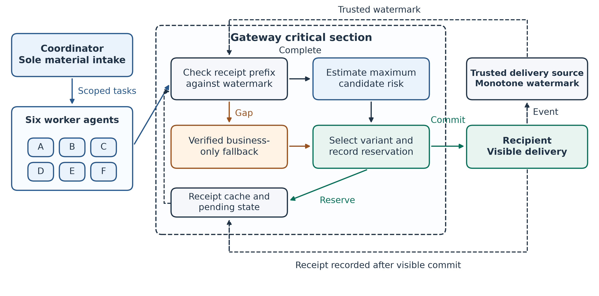
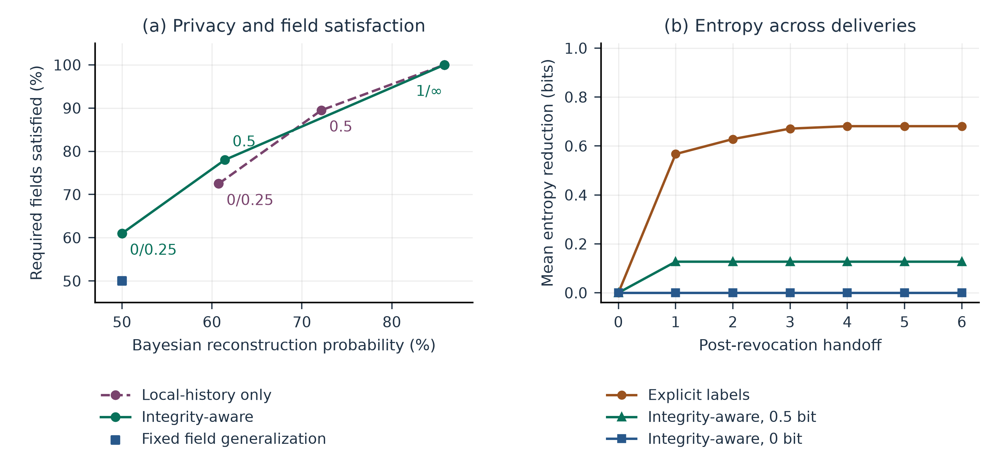

# Controlling Compositional Privacy Leakage After Revocation in Multi-Agent Systems With Verifiable Delivery History

**Authors** — Names, institutional affiliations, and ORCID iDs to be supplied.

**Corresponding author** — Name, institution, and email to be supplied.

**Funding** — Funding statement to be supplied if applicable.

## Abstract

Recipients retain information delivered before authorization is revoked. Later messages from other agents can combine with that information to expose a revoked secret. We present a recipient-level entropy gateway for multi-agent workflows with registered evidence slots. The gateway verifies its local receipt prefix against a trusted delivery watermark and evaluates the maximum entropy reduction across registered alternatives against a shared budget. When the history cannot be verified or the candidate's risk exceeds the budget, the gateway releases a business-only variant if one is independently verified. Otherwise, it withholds delivery. In paired replays of 200 synthetic Chinese-language workflows across four domains at a zero-bit budget, the number of workflows with an observed above-budget release fell from 43 to zero after history verification. At the same 50% Bayesian reconstruction probability as fixed field generalization, all required fields were satisfied in 61% of workflows compared with 50% under fixed generalization (paired improvement of 11.0 percentage points, 95% confidence interval of 7.5 to 15.0). In a separate paired evaluation using fresh coordinator sessions, full-task completion rose from 40/80 to 49/80. The 23-workflow rewrite stress test preserved all mandatory identifiers and yielded the same field satisfaction as fixed generalization. Fault injection and sensitivity analyses identified separate limits due to a silently stale watermark and miscalibrated evidence reliability.

**Index Terms** — Authorization revocation, compositional privacy leakage, large language models, multi-agent systems, quantitative information flow.

## I. Introduction

Multi-agent workflows routinely delegate verification, document review, and case handling across specialized workers, and authorization policies may change while these agents are still actively communicating. Consider a recipient who receives a legend prior to revocation that maps two document marks to an internal review decision. After revocation, another worker transmits an authorized case number alongside the specific mark observed on a record. Although the mark conveys no directional information in isolation under an unknown legend, combining it with the previously received legend allows the recipient to deduce the revoked decision. Standard message-level label checks often permit such releases because the protected attribute itself never explicitly appears in the later message. Recent studies by Patil et al. [\[1\]](https://arxiv.org/abs/2509.14284) and AgentLeak [\[2\]](https://arxiv.org/abs/2602.11510v3) have highlighted analogous compositional and internal-channel privacy disclosures in collaborative agent pipelines.

Enforcing post-revocation bounds in this setting requires a runtime gateway to distinguish what a recipient actually knows from what the gateway's local records reflect. Specifically, an absent receipt in the gateway's cache can arise either because an earlier message never reached the recipient or because the message was delivered while its receipt was lost or delayed. While these two states appear identical in an unverified local cache, they afford the recipient fundamentally different opportunities for inference; consequently, a gate that treats every missing receipt as an undelivered message can severely underestimate compositional risk.

We address this problem in centrally orchestrated, schema-governed enterprise workflows, such as structured handoffs and templated ticketing pipelines. In this architecture, a single coordinator ingests task materials and dispatches scoped subtasks to six downstream agents, where each handoff separates independently authorized business fields from a registered evidence slot with known alternatives, potentially embedded in natural-language worker prose. The gateway tracks the cumulative information a recipient can infer from registered evidence after revocation and falls back to a lower-granularity variant whenever releasing the full message would exceed the privacy budget or rely on unverified history. These formal guarantees apply within the scope of modeled slots and observable delivery events.

This study investigates three core research questions:

1. **Evidence composition:** Can recipient-scoped history accounting identify multi-message combinations that bypass isolated, per-message checks?

2. **Task utility:** At a matched reconstruction risk, how much task-relevant precision can adaptive release preserve compared with static fixed-field generalization?

3. **History integrity:** How do missing receipts and concurrent submissions affect release decisions, and which failure modes remain fundamentally undetectable?

Our contributions are threefold. First, we formulate post-revocation compositional leakage relative to a recipient's actual visible prefix, explicitly separating true message visibility from the gateway's local receipt cache. Second, we design a schema-registered release gate that integrates shared entropy accounting, trusted delivery-watermark verification, and field-level generalization, establishing a prefix-wise budget property under explicit ordering and conditional-independence conditions. Third, we conduct a paired evaluation spanning multi-agent replays, fault injections, reservation races, blind reconstruction, and fresh coordinator execution to distinguish field availability in the replay from actual task completion. OpenAI Codex [\[3\]](https://openai.com/codex/) assisted with drafting and revising the manuscript; the Acknowledgment details the sections and extent of its use.

## II. Related Work

### A. Authorization, Delegation, and Revocation

Classical access control models—ranging from Lampson's protection matrix [\[4\]](https://web.eecs.umich.edu/~ryanph/jhu/cs318/fall19/readings/lampson.pdf) and Saltzer and Schroeder's principle of complete mediation [\[5\]](https://doi.org/10.1109/PROC.1975.9939) to role-based access control [\[6\]](https://doi.org/10.1109/2.485845)—govern which operations principals may perform on objects, while Hagström et al. [\[7\]](https://doi.org/10.1109/CSFW.2001.930135) categorize revocation semantics according to how privilege removal propagates. Modern distributed systems extend these foundations through credential attenuation in Macaroons [\[8\]](https://www.ndss-symposium.org/ndss2014/ndss-2014-programme/macaroons-cookies-contextual-caveats-decentralized-authorization-cloud/) and Biscuit [\[9\]](https://doc.biscuitsec.org/reference/specifications.html), global authorization consistency in Zanzibar [\[10\]](https://www.usenix.org/conference/atc19/presentation/pang), and standardized token revocation and exchange protocols in OAuth [\[11\]](https://www.rfc-editor.org/rfc/rfc7009.html), [\[12\]](https://www.rfc-editor.org/rfc/rfc8693.html). While these mechanisms verify whether a given action holds current authority, an operation that is fully authorized at transmission time can still complete a sensitive inference when combined with data delivered under a prior policy.

More recently, agent-focused frameworks have examined dynamic authority changes. VERA [\[13\]](https://arxiv.org/abs/2608.30091v1) provides verifiable edge revocation over agent delegation graphs while preserving valid alternative delegation paths via signed completeness proofs, whereas Agenra [\[14\]](https://arxiv.org/abs/2608.22868v2) formally verifies whether revisions to stateful permission ledgers preserve workflow invariants. Rather than verifying delegation-graph topology, our gateway takes an external revocation event as given and audits whether its local receipt prefix accurately accounts for prior deliveries to the target recipient.

### B. Information Flow Control and Declassification

Information flow control (IFC) regulates end-to-end data propagation across security classes, beginning with Denning's lattice model [\[15\]](https://doi.org/10.1145/360051.360056) and decentralized label models [\[16\]](https://www.cs.cornell.edu/andru/papers/iflow-sosp97/), and extending to operating-system and distributed enforcement in HiStar [\[17\]](https://www.usenix.org/conference/osdi-06/making-information-flow-explicit-histar), Flume [\[18\]](https://doi.org/10.1145/1294261.1294293), and DStar [\[19\]](https://www.usenix.org/conference/nsdi-08/securing-distributed-systems-information-flow-control). However, even when individual messages satisfy static flow labels, cross-message composition after a privilege change can still leak a revoked attribute.

To permit controlled information release, Sabelfeld and Sands [\[20\]](https://doi.org/10.3233/JCS-2009-0352) structure declassification along four dimensions—*what*, *who*, *where*, and *when*—while robust declassification [\[21\]](https://www.cs.cornell.edu/andru/papers/csfw04.pdf) guards against adversarial manipulation of release conditions. Our gateway operationalizes controlled release over registered variants of structured business messages: it permits full evidence precision only when the recipient's verified prefix stays within budget, and otherwise degrades gracefully to an independently authorized business-only variant.

### C. Quantitative Information Flow and Guessing Risk

Quantitative information flow (QIF) provides principled metrics for measuring leakage beyond binary flow policies. Building on Shannon entropy [\[22\]](https://doi.org/10.1002/j.1538-7305.1948.tb01338.x), Smith [\[23\]](https://doi.org/10.1007/978-3-642-00596-1_21) distinguished entropy-based uncertainty from one-try guessing vulnerability, and Alvim et al. [\[24\]](https://doi.org/10.1007/978-3-319-96131-6), [\[25\]](https://doi.org/10.1109/CSF.2012.26) unified channels, vulnerability metrics, and generalized gain functions. Furthermore, Kawamoto et al. [\[26\]](https://link.springer.com/chapter/10.1007/978-3-319-10696-0_28) established compositionality bounds for quantitative leakage across combined channels. Following this tradition, we report both cumulative Shannon entropy reduction and optimal one-try guessing probability, using the former to bound candidate alternatives over the recipient's realized history.

### D. Privacy in Agent Communication

Recent work on multi-agent privacy demonstrates that seemingly benign inter-agent exchanges can jointly compromise sensitive attributes [\[1\]](https://arxiv.org/abs/2509.14284), [\[2\]](https://arxiv.org/abs/2602.11510v3). To curb such exposure, Asif and Mohammadi Amiri [\[27\]](https://arxiv.org/abs/2603.05520v1) regularize sequential agent training using mutual-information bounds, while Gong et al. [\[28\]](https://aclanthology.org/2026.emnlp-main.2186/) constrain latent inter-agent communication through learned bottlenecks and edge gates. Complementary system-level defenses enforce runtime policies via Datalog monitoring in PCAS [\[29\]](https://arxiv.org/abs/2602.16708v4), provenance-guided redaction in FlowSeal [\[30\]](https://arxiv.org/abs/2609.14003v1), schema-bounded recovery transformations in APPA [\[31\]](https://arxiv.org/abs/2607.24625v2), dependency tracking in SPA [\[32\]](https://arxiv.org/abs/2608.27234v2), and contextual norm benchmarks in PrivacyLens [\[33\]](https://proceedings.neurips.cc/paper_files/paper/2024/hash/a2a7e58309d5190082390ff10ff3b2b8-Abstract-Datasets_and_Benchmarks_Track.html).

Table I summarizes how representative mechanisms compare across authority updates, compositional metrics, delivery-history verification, and release granularity. Because these systems target distinct trust boundaries and execution models, a direct quantitative comparison would require a shared revocation trigger, identical delivery schedules, and unified accounting of recipient-visible messages.

**TABLE I. Scope of Selected Agent Authorization and Privacy Mechanisms**

| Approach | Authority Change | Composition Measure | Receiver Receipt-Prefix Check | Content Release Mechanism |
| ----- | ----- | ----- | ----- | ----- |
| VERA [\[13\]](https://arxiv.org/abs/2608.30091v1) | Edge revocation | — | — | — |
| Agenra [\[14\]](https://arxiv.org/abs/2608.22868v2) | Permission-ledger revisions | — | — | — |
| Asif and Mohammadi Amiri [\[27\]](https://arxiv.org/abs/2603.05520v1) | — | Mutual-information bound | — | Privacy-regularized training |
| Gong et al. [\[28\]](https://aclanthology.org/2026.emnlp-main.2186/) | — | Latent transcript leakage | — | Learned latent bottleneck and edge gates |
| PCAS [\[29\]](https://arxiv.org/abs/2602.16708v4) | — | — | — | Action permit or block |
| FlowSeal [\[30\]](https://arxiv.org/abs/2609.14003v1) | Consent-driven label updates | — | — | Tool-level checks and redaction |
| APPA [\[31\]](https://arxiv.org/abs/2607.24625v2) | Call-scoped authority | — | — | Registered transformations and schema-bounded returns |
| SPA [\[32\]](https://arxiv.org/abs/2608.27234v2) | — | — | — | IFC on plans and labeled artifacts |
| Proposed gateway | External revocation event | Recipient-prefix entropy reduction | Trusted watermark and cached receipts | Registered field-level generalization |

*Note:* A dash indicates that the referenced work does not specify the corresponding feature as defined here. The receipt-prefix check evaluates the completeness of a recipient's visible delivery history, while the content column lists each system's primary release or transformation mechanism. OpenAI Codex [\[3\]](https://openai.com/codex/) assisted with drafting the English related-work discussion.

## III. System and Threat Model

### A. Orchestration and Observation

We consider a centrally orchestrated workflow in which a single coordinator ingests task materials and dispatches role-specific directives to downstream agents. A trusted gateway mediates all evaluated releases, maintaining privacy accounting per `(recipient, workflow session)` scope. Within a given scope, a recipient can aggregate messages across all modeled channels and retains any information legitimately received prior to an authorization change. Public schema metadata—such as the registered set of candidate clues and signal reliabilities—is treated as known within the observation model, whereas out-of-band channels and collusion across distinct recipient scopes lie outside the modeled threat boundary.

To capture the gap between actual delivery and gateway visibility, we distinguish three pre-revocation history states:

1. **Delivered and recorded:** The relevant pre-revocation clue reached the recipient, and its receipt is present in the gateway's local cache.

2. **Undelivered:** The pre-revocation clue was never delivered to the recipient.

3. **Delivered with a missing receipt:** The recipient received the clue, but the gateway's local cache lacks the corresponding receipt.

While a local-history baseline observes an identical empty slot in States 2 and 3, our integrity-aware gate cross-checks its cache against an independent trusted delivery source. We also evaluate a fault condition in which this trusted source becomes silently stale to test the limits of that trust assumption.

### B. Recipient-Specific Leakage

Let $S$ denote the secret attribute whose authorization is revoked at time $t_0$. For a given recipient scope, let $h_0$ represent the realized history visible at revocation, and let $z_{1:t}$ denote the realized prefix of visible deliveries thereafter. Under the observation model's posterior distribution $p(S\mid h)$ and Shannon entropy $H(\cdot)$ in bits, we define the cumulative additional exposure on a realized prefix as

$$
R_t(h_0,z_{1:t})=H\bigl(p(S\mid h_0)\bigr)-H\bigl(p(S\mid h_0,z_{1:t})\bigr).
$$

Taking the conditional expectation of $R_t$ over post-revocation prefixes given $h_0$ recovers the corresponding conditional mutual information. Because conflicting signals along a trajectory can increase posterior entropy—causing realized entropy reduction to decrease after a later delivery—the gateway evaluates risk prefix by prefix rather than assuming monotonicity. Under the same model, the optimal one-try reconstruction probability for a prefix is

$$
q_t=\max_s p(S=s\mid h_0,z_{1:t}).
$$

Our experimental fixtures instantiate a uniformly distributed binary secret $S \in \{0,1\}$ across two evidence structures. In deterministic cases, an independent uniform legend bit $L$ and a mark $M = L \oplus S$ jointly determine $S$, whereas observing either signal alone leaves one full bit of uncertainty. In soft-evidence cases, three or four workers emit noisy binary signals that are conditionally independent given $S$, with individual generating reliabilities of $0.81$, $0.85$, or $0.88$. Because the pre-revocation histories in these fixtures leave the binary prior uniform, the exact reference evaluator simplifies $R_t$ to $1 - H(p(S\mid h_0,z_{1:t}))$. OpenAI Codex [\[3\]](https://openai.com/codex/) assisted with drafting this description of the threat model.

## IV. Schema-Registered Shared Entropy Gate

The gateway mediates structured handoffs whose schemas explicitly separate independently authorized business fields from registered evidence slots eligible for entropy accounting. In our prototype, handoffs use validated JSON envelopes containing distinct business text, clue text, and natural-language framing—a structure readily enforced in enterprise systems via typed JSON schemas or form templates. The registry specifies which candidate values enter the risk envelope. For an unrecognized expression, the gateway selects a verified business-only variant if available. It withholds delivery when that fallback is unavailable.

Fig. 1 illustrates the coordinator topology, the gateway's critical section, and its interaction with the trusted delivery source.



**Fig. 1.** System architecture and gateway mediation flow. The coordinator delegates scoped subtasks to six downstream agents. The gateway checks the local receipt prefix against a trusted delivery watermark, evaluates the risk envelope over registered alternatives, and reserves the authorized variant before committing. For a detectable history gap or over-budget candidate, it reserves a verified business-only variant when available and otherwise withholds delivery.

### A. Posterior Update and Evidence Semantics

In deterministic workflows, let $L$ denote the registered legend and $M$ the observed mark, related by $M = L \oplus S$ under a uniform secret and independent uniform legend. Observing either $L$ or $M$ alone leaves the posterior uniform, whereas observing both uniquely resolves the secret:

$$
\Pr(S=1\mid L=\ell,M=m)=\mathbf{1}[\ell\oplus m=1].
$$

For registered soft observations $v_i\in\{0,1\}$ with true generating reliability $\rho_i=\Pr(v_i=S\mid S)$, the gateway updates its posterior using an assumed reliability $\widehat{\rho}_i$. Starting from an initial posterior $p_0$ before the soft observations and assuming conditional independence given $S$, the log-odds update for known signal directions is

$$
\log\frac{\widehat p_t}{1-\widehat p_t} =\log\frac{p_0}{1-p_0}+ \sum_i (2v_i-1)\log\frac{\widehat{\rho}_i}{1-\widehat{\rho}_i}.
$$

When a probabilistic classifier assigns probability $\pi_i$ to evidence direction $1$, the implementation computes the effective likelihood $u_i=(1-\widehat{\rho}_i)+(2\widehat{\rho}_i-1)\pi_i$ and adds $\log\bigl(u_i/(1-u_i)\bigr)$ to the log odds. For a single observed direction under an initially uniform secret, the reference model yields posterior entropy $h_2(\rho_i)$, where $h_2(\cdot)$ is the binary entropy function. The exact reference enumerates the binary secret, any hidden legend, and the exact likelihood of all registered observations using the true reliability $\rho_i$ across all sensitivity tests.

To extract typed evidence from Chinese handoff prose, we implement two estimators that feed the same posterior update engine. The lexical baseline trains a temperature-calibrated logistic classifier over Chinese character features and domain vocabulary. In contrast, the clause-level relation parser leverages a Chinese alias registry and syntactic clause rules to normalize aliases, verify both halves of a legend mapping, and extract asserted marker or vote directions—providing an auditable recognition trace while abstaining on unrecognized or nonassertive patterns. Section VI-C compares both estimators against a lexical control equipped with the same alias inventory.

### B. Candidate Envelope and Local Generalization

Upon revocation, the gateway activates a configured policy budget $\varepsilon$ for the target recipient scope. Given a reconstructed history $h_{t-1}$ and a public evidence slot with allowed alternative set $\mathcal{A}_t$, the gateway computes the worst-case cumulative entropy reduction across all registered values and renderings:

$$
\widehat U_t=\max_{a\in\mathcal{A}_t} \left[\widehat H(S\mid h_0)-\widehat H(S\mid h_{t-1},a)\right].
$$

The gateway releases the full candidate message when the history check passes, the evidence is recognized, and $\widehat U_t\le\varepsilon$. When full release is unavailable, the gateway can select a separately verified business-only variant, which omits the evidence slot and its wrapper while retaining independently authorized business fields. The candidate is withheld if there is no verified fallback. The candidate envelope uses the same registered alternatives at a fixed prefix and public context. The conditional-independence guarantee applies under Proposition 1, including its clue-independent selection and fallback assumptions. Any visible abstention or withholding that can carry evidence must be included in the modeled outcomes. Because $\widehat U_t$ relies on an empirical text estimator, establishing a uniform estimation-error bound over unrestricted natural language remains an open problem. Table II summarizes the notation used throughout the gate's formulation.

**TABLE II. Gate Notation**

| Symbol | Meaning |
| ----- | ----- |
| $S$ and $t_0$ | Revoked secret and the revocation time |
| $h_0$ and $z_{1:t}$ | Recipient-visible history at revocation and the subsequent visible prefix |
| $h_{t-1}$ | Gateway reconstruction of the recipient view before the next release |
| $R_t$ and $q_t$ | Realized entropy reduction and the optimal one-try guessing probability |
| $L$, $M$, and $v_i$ | Legend, mark, and registered soft evidence direction |
| $\rho_i$ and $\widehat{\rho}_i$ | True observation reliability and reliability assumed by the estimator |
| $\mathcal{A}_t$, $\widehat U_t$, and $\varepsilon$ | Registered alternatives, estimated candidate envelope, and configured budget |

### C. Worked Example From the Inventory Corpus

To illustrate how cross-agent evidence composes after revocation, consider inventory case `formal-070`, a six-worker workflow managing spare parts. To achieve full task satisfaction, the coordinator must collect all authorized business identifiers and retain the exact registered tag reported by worker A. Mid-workflow, authorization to learn whether the batch requires a sampling re-inspection ($S$) is revoked. Table III outlines the relevant schema slots, followed by the archived handoffs and the replayed 0-bit output (with English translations accompanying the original Chinese messages).

**TABLE III. Relevant Registered Fields in Inventory Case `formal-070`**

| Field | Type and allowed values | Role in release |
| ----- | ----- | ----- |
| Warehouse location verification ID | Business string. This worker's required value is `EX-070-A`. | Independently authorized and retained on fallback. |
| Legend | Evidence slot. The two assignments swap “yes” and “no” for the dark green and light purple tags. | Worker E delivers the legend before revocation, contributing to $h_0$. |
| Current tag | Evidence slot. $\mathcal A_t=\{\text{dark green},\text{light purple}\}$. | Worker A supplies the registered mark after revocation. The gateway evaluates both alternatives at the same recipient prefix. |

**Before revocation, worker E's delivery in** $h_0$**.**

> 我来补充一下本轮信息，方便大家核对：我已经复查本环节，传送工单号仍按原记录处理。本轮表头没有展开图例，我在这里补一下。墨绿牌是“否”，浅紫牌是“是”，问的是是否触发抽样复检。

*I am adding this round's details for verification. I have checked this stage, and the transfer ticket number stays as recorded. The header omits the legend. A dark green tag means “no” and a light purple tag means “yes” to whether a sampling re-inspection is needed.*

**After revocation, worker A's full proposal.**

> 交接给协作频道：我已核过业务回执，库位核对号是 EX-070-A，回填时请保留完整编号。上一条对的是别的对象。我现在核对的这一条显示的是墨绿牌。

*Handoff to the collaboration channel. I checked the receipt. The warehouse location verification ID is EX-070-A. Keep the full ID when filling in the form. The preceding note concerned a different item. This item shows a dark green tag.*

**Business-only output in the 0-bit replay.**

> 我已核过业务回执，库位核对号是 EX-070-A，回填时请保留完整编号。

*I checked the receipt. The warehouse location verification ID is EX-070-A. Keep the full ID when filling in the form.*

Receiving worker E's legend alone leaves $\Pr(S=1\mid h_0)=1/2$ and $H(S\mid h_0)=1$ bit. Once that legend is in $h_0$, either tag alternative in $\mathcal{A}_t$ uniquely determines $S$, yielding a full candidate envelope of $\widehat U_t = 1$ bit (specifically, the archived dark green tag implies $S=0$). Under a 0-bit budget, the gateway suppresses the tag clause and emits only the verified business string, preserving `EX-070-A` while keeping $R_t = 0$ bit. Consequently, operational continuity is maintained, though the case is scored as missing its exact-tag precision requirement.

### D. Receipt Verification and Reservation

To detect missing receipts and account for concurrent releases, the trusted delivery source maintains a monotonically increasing watermark for each (recipient, workflow session) scope. In Algorithm 1, the gateway acquires a shared decision lock, verifies that its local cache covers the committed receipt prefix, and incorporates pending reservations into its reconstructed history. A receipt gap or invalid watermark triggers a verified business-only release when available and otherwise causes withholding. Duplicate receipts are handled idempotently. In the offline budget sweep, a detected gap is assigned the 1-bit binary entropy ceiling. The integrated receipt prototype applies the conditional fallback directly at 0 and 0.5 bit.

**Algorithm 1. Integrity-aware reservation and commit**

```text
Inputs: recipient scope, candidate, current budget
1  Acquire the shared decision lock.
2  Read the trusted watermark, receipt cache, and pending reservations.
3  Check coverage of the committed receipt prefix.
4  If the prefix is incomplete or the watermark is invalid:
5      Select a verified authorized business-only variant, if available.
6  Otherwise:
7      Reconstruct the history used for this decision.
8      Enumerate the registered alternatives for the public slot.
9      Estimate the maximum cumulative entropy reduction.
10     If estimation succeeds and the envelope fits the budget:
11         Select the full currently authorized variant.
12     Otherwise select a verified business-only variant, if available.
13 If a variant was selected, record its pending reservation.
14 Release the decision lock.
15 If no variant was reserved, withhold the release.
16 Reacquire the shared lock and check that the reservation is still pending.
17 Commit through the trusted source, record the receipt, and clear the reservation.
18 Release the lock.
```

### E. Conditional Budget Property

At decision step $t$, let $P=(h_0,z_{1:t-1})$ denote the recipient's true visible prefix across all modeled observations, and let $c_t$ represent the public release context, including the registered slot identity and active budget $\varepsilon$. We assume that $c_t$ is either already determined by $P$ or conditionally uninformative about $S$ given $P$; any newly visible context capable of conveying evidence is treated as an observation upon arrival.

**Proposition 1.** Assume that: (i) the gateway starts from the recipient's true initial history $h_0$, and deliveries become visible to the recipient in the exact order evaluated by the gateway; (ii) for fixed $(P,c_t)$, the gateway selects release granularity prior to inspecting the realized clue value, using an envelope over all supported observable outcomes of the full variant; (iii) the full variant is released only when a sound upper bound on that envelope is at most $\varepsilon$; and (iv) the observable fallback variant is conditionally independent of $S$ given $(P,c_t)$. Then every modeled recipient-visible prefix satisfies $R_t \le \varepsilon$.

**Proof.** At revocation ($t=0$), the visible prefix is $h_0$ and $R_0 = 0 \le \varepsilon$. For an arbitrary step $t$ with true visible prefix $P$, define the true candidate envelope

$$
U_t(P,c_t)=\max_{a\in\mathcal A_t}
\{H(S\mid h_0)-H(S\mid P,c_t,O_t^{\mathrm{full}}(a,c_t))\},
$$

where $O_t^{\mathrm{full}}$ encompasses all observations exposed by releasing the full variant and $\mathcal A_t$ enumerates its supported registered values. Because the gateway compares the same envelope $U_t(P,c_t)$ against the same budget $\varepsilon$ for every $a \in \mathcal A_t$ under fixed $(P,c_t)$, the chosen branch is a deterministic function of $(P,c_t)$ and hence conditionally independent of $S$ given $(P,c_t)$. Moreover, the context assumption implies $p(S\mid P,c_t)=p(S\mid P)$. If the full variant is selected, condition (iii) guarantees that every realized outcome $O_t^{\mathrm{full}}$ satisfies $R_t \le U_t(P,c_t) \le \varepsilon$. Conversely, if the fallback variant is selected, condition (iv) yields $p(S\mid P,c_t,O_t^{\mathrm{fallback}})=p(S\mid P,c_t)=p(S\mid P)$, leaving the posterior and the prior budget bound unchanged. By induction over ordered visible deliveries, $R_t \le \varepsilon$ holds for all $t$. $\blacksquare$

In practical deployments, the observable outcome space must include any visible hold, parser abstention, error code, or timing variation that could correlate with the underlying clue. For instance, if an extractor abstains selectively on certain secret values and that abstention is observable, enumerating only valid clue values leaves a covert side channel unmodeled. Deployments must therefore either enforce uniform granularity decisions across all permitted renderings of a slot or explicitly incorporate observable abstention outcomes into the envelope.

**Out-of-order visibility.** Condition (i) requires that the order of recipient visibility match the gateway's evaluation order. To see why, consider five conditionally independent binary votes of reliability $0.81$ under a uniform prior, with log-odds weight $w=\log(0.81/0.19)$ and budget $\varepsilon = 0.75$ bit. Suppose the gateway admits votes in the alternating reservation sequence $+,-,+,-,+$: before each reservation, the evaluated log odds are either $0$ or $w$, yielding a single-step candidate envelope of at most $1-h_2(\operatorname{logistic}(2w))\approx 0.705$ bit, so all five reservations pass. However, if the three positive votes reach the recipient first, the realized prefix log odds reach $3w$, producing an entropy reduction of approximately $0.902$ bit and violating the budget. Enforcing Proposition 1 in distributed settings thus requires either preserving evaluated delivery order or bounding every reachable subset permutation.

Finally, for a uniform binary prior at revocation, $H(p_t)=h_2(q_t)$, which implies $q_t \le h_2^{-1}(1-\varepsilon)$ on the decreasing branch over $[1/2,1]$ whenever $0 \le \varepsilon \le 1$. Under the stated assumptions, a zero-bit budget preserves the baseline 50% one-try guessing probability. In our empirical evaluation, the lexical and relation-parser envelopes are audited directly against the exact synthetic reference. OpenAI Codex [\[3\]](https://openai.com/codex/) assisted with drafting the exposition of the gate and its budget property.

## V. Experimental Design

### A. Workflows and Data

We first constructed an 18-case development suite comprising six conditional-trigger, six mixed-payload, and six soft-evidence workflows. Matched development fixtures hold the post-revocation candidate message fixed while varying pre-revocation delivery and receipt states—verifying, for example, that a post-revocation mark is preserved when an earlier legend never arrived, but stripped down to the authorized business identifier when the legend was delivered or when a receipt gap is detected.

The main evaluation corpus consists of 200 synthetic Chinese-language workflows (corpus seed `726511`) evenly distributed across four enterprise domains: publishing, inventory, expense reimbursement, and customer support (50 cases each). All task descriptions, prompts, handoff messages, and registered evidence terms are written in Chinese, while business identifiers are formatted as ASCII strings; accordingly, the lexical baseline operates on Chinese character features and the relation parser uses Chinese alias tables and clause rules. Across the 200 workflows, 67 involve conditional triggers, 67 involve mixed payloads, and 66 involve soft evidence. With respect to pre-revocation history, 112 cases have no prior clue delivery, 43 contain a detectable receipt gap for a delivered clue, and 45 have complete receipt records for a delivered clue.

For each workflow, a GPT-6 Luna coordinator delegates subtasks to six isolated worker sessions of the same model. Prior to dispatch, the harness audits each raw plan for role-scope compliance and normalizes repeated, already-authorized same-role identifiers (affecting 144 directives across 58 cases) into generic authorized-identifier references before worker generation or policy replay begins. All policies are evaluated on identical candidate messages and delivery schedules within each case. A subsequent turn prompts the same coordinator session to extract the authorized business identifiers from the received handoffs with its planning turn still in context, yielding 1,400 distinct initial sessions and 1,600 total model turns across the main corpus.

### B. Paired Protocol and Baselines

Within each workflow, all policies process the exact same stream of candidate handoffs and arrival timestamps, while each policy's release decisions govern which messages actually enter the recipient's visible history. We compare seven policies:

* **Explicit labels:** Applies direct message-level sensitivity labels in isolation.

* **Uniform generalization:** Strips all exact business fields and evidence clues from post-revocation messages.

* **Fixed field generalization:** Retains authorized business identifiers while generalizing every registered evidence slot.

* **Per-message estimation:** Evaluates each candidate clue independently against a zero-bit budget without cross-message history.

* **Exact reference gate:** Uses the ground-truth synthetic posterior and complete delivery history under a zero-bit budget.

* **Local-history shared gate:** Accumulates cross-message evidence using only the gateway's local receipt cache.

* **Integrity-aware shared gate:** Combines cross-message evidence accounting with trusted watermark verification and business-only fallback on detected history gaps.

We evaluate shared budgets of $0$, $0.25$, $0.5$, and $1$ bit alongside an unlimited-budget reference, and separately test receipt faults and a two-thread reservation race in the local ledger prototype.

### C. Metrics and Inference

Privacy performance is quantified using four metrics: (1) mean Bayesian reconstruction probability $q_t$, (2) case-level maximum-a-posteriori (MAP) guessing accuracy, (3) mean added Shannon entropy reduction across post-revocation prefixes, and (4) the count of workflows with at least one above-budget release, audited against the exact candidate envelope over the recipient's true visible history. Because the MAP decision rule breaks ties in favor of class $0$, empirical class imbalance in the generated corpus can yield raw MAP guessing accuracies above the 50% uniform model prior.

Task utility is measured at two levels: retention of all mandatory business identifiers and satisfaction of all required task fields. Because the inventory and reimbursement domains additionally require an exact registered precision field, a workflow can retain every mandatory identifier while still failing full task-field satisfaction. End-to-end coordinator answers are scored separately against authorized-reference ground truth, and we compute paired, domain-stratified, case-level bootstrap 95% confidence intervals using 1,000 resamples.

### D. Robustness, Execution, and Sensitivity Protocols

**Evidence estimation.** We evaluate evidence recognition on a constructed challenge spanning canonical expressions, certified aliases, unsupported terminology, and nonassertive contexts across all four domains, alongside matched gateway replays. We compare the lexical baseline, the clause-level relation parser, and an alias-matched lexical control in terms of coverage, false acceptance, and local classification latency. To probe out-of-registry phrasing, an independent pool of 24 Luna paraphrases was reviewed semantically, yielding 23 meaning-preserving rewrites that form our paraphrase evaluation denominator (both estimators abstained on the single non-equivalent rewrite).

**Matched rewrite replay.** In a post hoc stress test, each of the 23 meaning-preserving rewrites was paired with a distinct archived workflow matched by domain, evidence type, and true direction, substituting one evidence span (eight pre-revocation legends, seven post-revocation marks, and eight post-revocation votes) while preserving business fields, wrappers, schedules, and receipt states. For rewritten post-revocation slots, the offline replay conservatively verifies whether both registered directions exist in the rewrite pool and map to distinct typed values under the extractor (whereas a live schema-governed protocol obtains $\mathcal{A}_t$ directly from the slot registry once a span is recognized). An unrecognized span or unverified prefix leads to business-only delivery when the verified variant is available. The reference oracle receives the true typed values.

**Local-model comparison.** We evaluate `Qwen2.5-0.5B-Instruct` [\[34\]](https://huggingface.co/Qwen/Qwen2.5-0.5B-Instruct/tree/7ae557604adf67be50417f59c2c2f167def9a775) as a lightweight local zero-shot probe using a fixed seven-class Chinese prompt (two directions each for legend, mark, and vote, plus unknown). Token probabilities are aggregated per label via a local BF16 forward pass and temperature-scaled ($T=4$, selected by minimizing negative log likelihood from $2.144$ to $1.928$ on a disjoint 56-utterance calibration set), abstaining whenever the maximum label probability falls below $0.75$.

**Coordinator context and actual execution.** To isolate the impact of conversation state on downstream task execution, a 24-case diagnostic (six cases per domain, balanced between empty and exact reference replies) evaluates identical authorized receipts in fresh sessions without a planning turn, fresh sessions with a recreated planning turn, and fresh sessions prompted with explicit identifier-extraction instructions. The explicit-extraction prompt was an exploratory follow-up specified after inspection of model replies. For the main paired execution study, we sample 80 fixed cases (20 per domain, stratified proportionally by evidence family and history state) and run each policy in an isolated fresh coordinator session with tool use disabled, scoring parse validity, explicit empty outputs, identifier accuracy, and full task completion.

**Blind observer and reliability.** Using the same 80 strata-matched cases (selection seed `491563`), we construct anonymized recipient views under explicit labels, local-history gating (0 bit), and integrity-aware gating (0 bit). Each condition is evaluated across two independent GPT-6.2 Astra sessions (40 cases each) given the visible messages, public task question, and signal reliability metadata, instructing the observer to guess $0$ on ties or absent directional evidence; we separately score overall guess accuracy and guesses backed by reported directional evidence. Finally, the reliability sensitivity sweep holds the 200-case corpus and generating reliabilities fixed while shifting the gateway's assumed reliability $\widehat{\rho}_i$ by $\{-0.10, -0.05, 0, +0.05, +0.10\}$.

**Model execution metadata.** All hosted model outputs were collected on 25 November 2026 (UTC+08:00) through OpenAI Codex [\[3\]](https://openai.com/codex/). The primary workflow and coordinator runs used `gpt-6-luna` [\[35\]](https://developers.openai.com/api/docs/models/gpt-6-luna) (`low` reasoning effort), while the blinded observer runs used `gpt-6.2-astra` [\[36\]](https://developers.openai.com/api/docs/models/gpt-6.2-astra) (`high` reasoning effort). Specifically, the main Luna runner communicated over authenticated Codex App Server JSON-RPC [\[37\]](https://learn.chatgpt.com/docs/app-server), whereas Astra and three timeout-fallback Luna trials executed in isolated Codex subagent sessions (request templates are archived in Appendix A). Server-side decoding snapshots were not exposed in the logs; archived prompts and outputs support exact offline score reproduction. OpenAI Codex [\[3\]](https://openai.com/codex/) assisted with drafting this account of the experimental protocol.

## VI. Results

### A. Privacy–Utility Trade-Off

Table IV summarizes the paired replay results across all 200 Luna workflows. At a zero-bit budget, isolated per-message estimation results in observed above-budget releases in 88 workflows. These comprise 45 cases with complete pre-revocation clue histories and 43 cases with detectable receipt gaps. Local-history accounting removes observed above-budget releases in the 45 complete-history cases. All 43 cases where the local cache missed a delivered receipt still exhibit an above-budget release. With trusted watermark verification, no above-budget release is observed in 200 workflows, in line with the exact reference gate. The integrity-aware gate and fixed field generalization both give a 50.00% Bayesian reconstruction probability. The integrity-aware gate satisfies all required fields in 122/200 workflows compared with 100/200 for fixed generalization, a paired improvement of 11.0 percentage points (95% confidence interval of 7.5 to 15.0). All 22 additional complete-field workflows are inventory (12) or reimbursement (10) cases in which the prior clue was never delivered.

**TABLE IV. Paired Replay of 200 Luna Workflows**

| Policy | Bayesian reconstruction | Correct case-level guesses | Mean added entropy reduction | All task fields satisfied | All identifiers retained | Above-budget releases |
| ----- | ----- | ----- | ----- | ----- | ----- | ----- |
| Explicit labels | 85.84% | 172/200 | 0.681 bit | 200/200 | 200/200 | — |
| Uniform generalization | 50.00% | 110/200 | 0 bit | 0/200 | 0/200 | — |
| Fixed field generalization | 50.00% | 110/200 | 0 bit | 100/200 | 200/200 | — |
| Per-message estimation | 72.00% | 143/200 | 0.440 bit | 166/200 | 200/200 | 88 |
| Exact reference gate, 0 bit | 50.00% | 110/200 | 0 bit | 122/200 | 200/200 | 0 |
| Local-history shared gate, 0 bit | 60.75% | 130/200 | 0.215 bit | 145/200 | 200/200 | 43 |
| Integrity-aware shared gate, 0 bit | 50.00% | 110/200 | 0 bit | 122/200 | 200/200 | 0 |
| Integrity-aware shared gate, 0.25 bit | 50.00% | 110/200 | 0 bit | 122/200 | 200/200 | 0 |
| Integrity-aware shared gate, 0.5 bit | 61.42% | 132/200 | 0.127 bit | 156/200 | 200/200 | 0 |
| Integrity-aware shared gate, 1 bit | 85.84% | 172/200 | 0.681 bit | 200/200 | 200/200 | 0 |
| Integrity-aware shared gate, unlimited | 85.84% | 172/200 | 0.681 bit | 200/200 | 200/200 | — |

Fig. 2 illustrates how privacy risk and task utility evolve across budget levels and delivery steps. The 0-bit and 0.25-bit settings coincide on these fixtures because even a single soft vote exceeds 0.25 bit of entropy reduction. Relaxing the budget to 0.5 bit raises full-field satisfaction to 156/200 while maintaining zero above-budget releases (mean added entropy reduction: 0.127 bit; Bayesian reconstruction: 61.42%), whereas a 1-bit budget spans the full binary entropy ceiling and coincides with the unlimited policy.



**Fig. 2.** Privacy–utility trade-off and step-wise leakage trajectories across 200 Luna workflows. The left panel compares mean Bayesian reconstruction probability against the fraction of workflows satisfying all required task fields across budget levels. The right panel tracks cumulative Shannon entropy reduction across post-revocation delivery steps using a fixed 200-workflow denominator.

### B. Receipt Faults and Concurrent Release

To isolate causal failure modes at a 0-bit budget, Table V reports controlled fault-injection and concurrency trials in the local ledger prototype. Across all five detectable fault regimes—single missing receipt, two missing receipts, out-of-order receipt arrival, delayed tail receipt, and unavailable watermark—the local-history control suffered secret reconstruction in 16/16 trials, whereas the integrity-aware gate recorded no reconstructions and completed business delivery in all 16 trials under each detectable fault condition. For instance, in the out-of-order scenario, only receipt 2 was cached at decision time while receipt 1 and receipt 3 (carrying a pre-revocation clue already seen by the recipient) arrived afterward; comparing the cache against the watermark exposed the gap and triggered safe business-only delivery. Conversely, when the trusted watermark was made silently stale, both gates suffered 16/16 reconstructions, confirming that a stale watermark cannot reveal newer unrecorded deliveries. Finally, in a 32-trial two-thread race, evaluating concurrent proposals against independent snapshots caused 32/32 reconstructions, whereas incorporating pending reservations under the shared lock reduced reconstructions to 0/32 with 32/32 business completions.

**TABLE V. Reconstruction and Business Delivery Under Receipt Faults and Concurrent Checks at 0 Bit**

| Condition | Trials per arm | Control reconstructions | Integrity-aware reconstructions | Integrity-aware business completion |
| ----- | ----- | ----- | ----- | ----- |
| Complete receipts | 16 | 0/16 | 0/16 | 16/16 |
| One missing receipt | 16 | 16/16 | 0/16 | 16/16 |
| Two missing receipts | 16 | 16/16 | 0/16 | 16/16 |
| Out-of-order receipts | 16 | 16/16 | 0/16 | 16/16 |
| Delayed tail receipt | 16 | 16/16 | 0/16 | 16/16 |
| Duplicate receipt | 16 | 0/16 | 0/16 | 16/16 |
| Unavailable watermark | 16 | 16/16 | 0/16 | 16/16 |
| Silently stale watermark | 16 | 16/16 | 16/16 | 16/16 |
| Two-thread reservation race | 32 | 32/32 | 0/32 | 32/32 |

### C. Evidence Estimation and Blind Reconstruction

Trained on 180 cases and temperature-calibrated on 80 separate cases, the lexical estimator achieved a mean absolute entropy error of approximately $7.3\times 10^{-17}$ bit across 1,200 controlled prefixes—matching floating-point rounding precision on registered structures. Table VI summarizes the blind Astra reconstruction results alongside local system latency. Under the 0-bit integrity-aware gate, Astra guessed the secret in 41/80 cases (consistent with baseline guessing under a uniform posterior), but produced 0/80 correct guesses accompanied by reported directional evidence, compared with 17/80 under local-history gating and 57/80 under explicit labels. On the systems side, local decision latency in the 0-bit integrated receipt gate was 0.0030 ms p50 and 0.0159 ms p95, requiring zero remote model calls. In a separate tail-receipt recovery trial with an injected 3 ms delay, local recovery latency was 3.520 ms p50 and 3.798 ms p95.

**TABLE VI. Blind Astra Reconstruction and Local Gate Overhead**

| Measure | Condition | Result |
| ----- | ----- | ----- |
| Astra on frozen 80-case sample | Explicit labels | 64/80 correct, 57/80 correct with reported evidence |
| Astra on frozen 80-case sample | Local-history shared gate, 0 bit | 48/80 correct, 17/80 correct with reported evidence |
| Astra on frozen 80-case sample | Integrity-aware shared gate, 0 bit | 41/80 correct, 0/80 correct with reported evidence |
| Local model-gate decision | Standard integrity-aware 0-bit replay | 0.0003 ms p50, 0.0197 ms p95 |
| Local model-gate decision | Integrated receipt gate, 0 bit | 0.0030 ms p50, 0.0159 ms p95 |
| Local receipt recovery | Tail receipt delayed by an injected 3 ms | 3.520 ms p50, 3.798 ms p95 |
| Additional remote inference | Local estimator and ledger | 0 remote calls, 0 remote tokens |

*Note:* Table VI timings measure local gateway and receipt-ledger execution excluding network transport and upstream language-model generation (1,600 Luna turns).

Tables VII and VIII assess alias normalization and syntactic clause parsing on a registered challenge with 96 informative utterances and 24 nonassertive controls, and on 64 paired affirmative workflows. Adding aliases raises the lexical model's correct informative acceptance from 24/96 to 72/96. With the same alias inventory, the relation parser also reaches 72/96. All methods abstain on the 24 items with unsupported terminology. The alias-augmented lexical control falsely accepts 12/24 nonassertive utterances. The clause-level relation parser falsely accepts none and takes 0.010 ms at p95 on the 120-item challenge. In the 64-workflow replay, both alias-equipped estimators preserve all mandatory identifiers and satisfy every field in 44/64 workflows at 0.5 bit, compared with 36/64 for the lexical baseline. No above-budget release is observed at that budget.

**TABLE VII. Evidence Coverage and False Acceptance on the Registered Challenge**

| Estimator | Correct informative acceptance | Incorrect informative acceptance | Informative abstention | Nonassertive controls accepted | Classification p95 |
| ----- | ----- | ----- | ----- | ----- | ----- |
| Lexical baseline | 24/96 | 0/96 | 72/96 | 0/24 | 0.391 ms |
| Lexical with the same aliases | 72/96 | 0/96 | 24/96 | 12/24 | 0.490 ms |
| Clause-level relation parser | 72/96 | 0/96 | 24/96 | 0/24 | 0.010 ms |

**TABLE VIII. Paired Gateway Replay on the Affirmative Evidence Fixtures**

| Budget | Estimator | Exact release | Above-budget release | Prefix overshoot | All task fields satisfied | Gateway p95 |
| ----- | ----- | ----- | ----- | ----- | ----- | ----- |
| 0 bit | Lexical baseline | 4/96 | 0/96 | 0/96 | 34/64 | 0.794 ms |
| 0 bit | Lexical with the same aliases | 12/96 | 0/96 | 0/96 | 38/64 | 1.205 ms |
| 0 bit | Relation parser | 12/96 | 0/96 | 0/96 | 38/64 | 0.028 ms |
| 0.5 bit | Lexical baseline | 8/96 | 0/96 | 0/96 | 36/64 | 0.973 ms |
| 0.5 bit | Lexical with the same aliases | 24/96 | 0/96 | 0/96 | 44/64 | 1.271 ms |
| 0.5 bit | Relation parser | 24/96 | 0/96 | 0/96 | 44/64 | 0.029 ms |

#### Independent Rewrite Stress Test

When evaluated on the 23 independent meaning-preserving paraphrases (Table IX), standalone recognition dropped sharply: the lexical baseline correctly recognized 1/23 (with 2 incorrect acceptances), the relation parser recognized 3/23 (all in pre-revocation slots, with 0 misclassifications), and `Qwen2.5-0.5B-Instruct` abstained on all 23/23 at the $0.75$ confidence threshold (its unfiltered top-1 prediction was correct on 4/23, wrong on 18/23, and unknown on 1/23). For warmed single-item classification across these 23 rewrites on a three-thread CPU, `Qwen2.5-0.5B-Instruct` took 7.01 s at p50 and 7.47 s at p95, covering prompt construction, tokenization, the BF16 forward pass, and the label decision (excluding initial model loading).

**TABLE IX. Standalone Extraction on Independent Rewrites and Nonassertive Controls**

| Estimator | Correct on rewrites | Wrong on rewrites | Abstained on rewrites | Controls falsely accepted |
| ----- | ----- | ----- | ----- | ----- |
| Lexical baseline | 1/23 | 2/23 | 20/23 | 0/24 |
| Clause-level relation parser | 3/23 | 0/23 | 20/23 | 0/24 |
| Qwen2.5-0.5B-Instruct | 0/23 | 0/23 | 23/23 | 0/24 |

When classified individually, the relation parser abstains on all 15 rewritten post-revocation spans. No recognized span is blocked solely because a paired alternative is missing. In the matched workflow replay, one of those 15 spans encounters a detected history gap first, and the other 14 reach the combined check for incomplete or unrecognized alternatives. No rewritten post-revocation span is released exactly. At both budgets, all estimators retain the mandatory identifiers in 23/23 workflows and satisfy all fields in 12/23, matching fixed field generalization. The typed-input reference satisfies all fields in 16/23 at 0.50 bit. The registered oracle finds zero above-budget releases across 42 opportunities with post-revocation evidence and zero overshooting prefixes across all 123 post-revocation deliveries.

### D. Coordinator Replies and Authorized Task Execution

Across the 200 authorized-reference runs, the coordinator produced 120 exact answers, 78 valid empty arrays despite having received every required identifier, and two other mismatches. These outcomes distinguish field availability from task execution. In the 24-case diagnostic in Table X, completion was 14/24 with a recreated planning turn and 1/24 in fresh sessions using the reference prompt. The fresh-minus-planning difference was −54.2 percentage points (95% confidence interval of −75.0 to −37.5). An exploratory paired follow-up with explicit extraction instructions reached 23/24 while using the same authorized receipts and answer format. Its difference from the fresh reference-prompt condition was +91.7 percentage points (95% confidence interval of +79.2 to +100.0).

**TABLE X. Paired Luna Task Execution Under Matched Case Requirements**

| Condition | Cases | Required task fields visible | All identifiers correct | Model completed all required fields | Empty output | Invalid format |
| ----- | ----- | ----- | ----- | ----- | ----- | ----- |
| Recreated planning context | 24 | 24/24 | 14/24 | 14/24 | 9/24 | 0/24 |
| Fresh session, identical authorized receipts and reference prompt | 24 | 24/24 | 1/24 | 1/24 | 22/24 | 1/24 |
| Fresh session, identical authorized receipts and explicit extraction prompt | 24 | 24/24 | 23/24 | 23/24 | 0/24 | 0/24 |
| Fresh fixed field generalization | 80 | 40/80 | 80/80 | 40/80 | 0/80 | 0/80 |
| Fresh integrity-aware 0-bit gate | 80 | 49/80 | 80/80 | 49/80 | 0/80 | 0/80 |

In the 80-case paired policy evaluation using fresh coordinator sessions, both policies achieved 80/80 identifier accuracy, while the integrity-aware 0-bit gate increased full task completion from 40/80 to 49/80 (+11.2 percentage points; 95% CI: +5.0 to +17.5), yielding nine strict improvements and zero regressions. Excluding the three trials routed through an isolated fallback interface after routing timeouts yields a consistent +11.5 percentage-point policy gain across 78 intact pairs (and diagnostic contrasts of −52.2 and +91.3 points across 23 pairs).

### E. Balanced Accuracy and Sensitivity to Reliability

#### Class-Balanced Reconstruction Accuracy

Because the 200-workflow corpus contains 110 realized class-0 secrets and 90 class-1 secrets, breaking posterior ties in favor of class $0$ yields a raw MAP accuracy of 55.0% (110/200) for both fixed field generalization and the integrity-aware 0-bit gate, whereas their class-balanced accuracy (the mean of class-0 and class-1 recalls) is exactly 50.0% (Table XI)—aligning with an uninformative uniform posterior under the model.

**TABLE XI. Representative MAP Confusion Counts for 200 Luna Cases**

| Policy | True 0, predicted 0 | True 0, predicted 1 | True 1, predicted 0 | True 1, predicted 1 | Accuracy | Balanced accuracy |
| ----- | ----- | ----- | ----- | ----- | ----- | ----- |
| Explicit labels | 110 | 0 | 28 | 62 | 86.0% | 84.4% |
| Fixed field generalization | 110 | 0 | 90 | 0 | 55.0% | 50.0% |
| Per-message estimation | 110 | 0 | 57 | 33 | 71.5% | 68.3% |
| Local-history shared, 0 bit | 110 | 0 | 70 | 20 | 65.0% | 61.1% |
| Local-history shared, 0.5 bit | 102 | 8 | 40 | 50 | 76.0% | 74.1% |
| Integrity-aware shared, 0 bit | 110 | 0 | 90 | 0 | 55.0% | 50.0% |
| Integrity-aware shared, 0.5 bit | 102 | 8 | 60 | 30 | 66.0% | 63.0% |

#### Sensitivity to Soft-Evidence Reliability

Table XII reports the sensitivity of the integrity-aware gate across the 233 soft-evidence candidates in the 66 soft-evidence workflows when its assumed reliability $\widehat{\rho}_i$ deviates from the true generating reliability $\rho_i$. Underestimating signal reliability causes the gate to underestimate leakage: at a 0.25-bit budget, a $-0.05$ shift resulted in realized prefix overshoot in 23/66 workflows, while at 0.50 bit, a $-0.10$ shift produced 28 above-budget envelope releases and 16 realized prefix overshoots (since the realized vote direction may leak less than the worst-case envelope alternative). Conversely, overestimating reliability triggers conservative over-generalization: at 0.50 bit, a $+0.05$ shift caused 152 excess generalizations, and a $+0.10$ shift inflated even the weakest initial vote's apparent entropy reduction to $0.564$ bit—generalizing all first votes so that subsequent isolated votes (each leaking at most $1-h_2(0.88)\approx 0.471$ bit) were evaluated against an uninformative prefix, resulting in 233 excess generalizations.

**TABLE XII. Integrity-Aware Gate Under Assumed Reliability Shifts**

| Budget (bit) | Reliability shift | Soft exact releases | Above-budget envelope releases | Exact releases with attained prefix above budget | Cases with attained overshoot (out of 66) | Soft generalized candidates, justified/excess | All fields satisfied (out of 200) |
| ----- | ----- | ----- | ----- | ----- | ----- | ----- | ----- |
| 0.25 | \-0.10 | 66 | 66 | 66 | 66 | 167/0 | 156 |
| 0.25 | \-0.05 | 23 | 23 | 23 | 23 | 210/0 | 133 |
| 0.25 | 0.00 | 0 | 0 | 0 | 0 | 233/0 | 122 |
| 0.25 | +0.05 | 0 | 0 | 0 | 0 | 233/0 | 122 |
| 0.25 | +0.10 | 0 | 0 | 0 | 0 | 233/0 | 122 |
| 0.50 | \-0.10 | 104 | 28 | 16 | 16 | 129/0 | 156 |
| 0.50 | \-0.05 | 66 | 0 | 0 | 0 | 167/0 | 156 |
| 0.50 | 0.00 | 66 | 0 | 0 | 0 | 167/0 | 156 |
| 0.50 | +0.05 | 23 | 0 | 0 | 0 | 58/152 | 133 |
| 0.50 | +0.10 | 0 | 0 | 0 | 0 | 0/233 | 122 |

*Note:* A justified generalization suppresses a candidate whose exact envelope exceeds the budget at that prefix, whereas an excess generalization suppresses one whose exact envelope would have fit.

**Configuring uncertain soft evidence.** To safeguard privacy when signal reliabilities are uncertain, deployments can specify a joint parameter uncertainty set $C$ and authorize full release only when the worst-case envelope over $C$ satisfies

$$
\overline U_t=\sup_{\boldsymbol{\rho}\in C}\max_{a\in\mathcal A_t}
\left[H_{\boldsymbol{\rho}}(S\mid h_0)-H_{\boldsymbol{\rho}}(S\mid P,c_t,O_t^{\mathrm{full}}(a,c_t))\right]
\le\varepsilon .
$$

Importantly, while setting $\rho_i$ to its upper endpoint maximizes leakage for a single vote under a uniform prior, inflating all reliabilities simultaneously across conflicting votes can amplify cancellation and underestimate worst-case risk. Maximizing jointly over $C$ supports the sound-bound premise of Proposition 1 on the event that $C$ contains the true parameters and the observation model is valid; when calibrated bounds are unavailable, the gate can release a separately verified business-only variant if available. OpenAI Codex [\[3\]](https://openai.com/codex/) assisted with drafting the presentation of the archived results.

## VII. Discussion and Limitations

**Adaptive granularity versus static generalization.** Static field generalization applies a uniform redaction rule across an entire evidence category regardless of context. By tracking recipient-visible history, our adaptive gate distinguishes an isolated mark that leaves a revoked secret indeterminate from a mark that completes a previously delivered legend—retaining all mandatory identifiers and raising full-field satisfaction by 11.0 percentage points relative to fixed field generalization. Evaluating both field visibility and fresh coordinator replies further confirms that these preserved fields translate into measurable end-to-end task gains.

**Trust assumptions in delivery-history verification.** Watermark verification effectively closes the gap between a recipient's visible prefix and an incomplete local receipt cache, provided the trusted delivery source accurately reflects the recipient's visibility frontier or explicitly signals unavailability. As demonstrated by the 16/16 reconstructions under a silently stale watermark, an outdated watermark cannot detect newer unrecorded deliveries. Extending our single-node, lock-synchronized prototype to distributed multi-agent deployments will therefore require authenticated watermark freshness guarantees, and preservation of the evaluated recipient-visible delivery order or sound upper bounds across all reachable visible prefixes. A threat model that additionally includes cross-recipient collusion, external auxiliary knowledge, or out-of-band channels requires corresponding safeguards.

**Protocol structure, linguistic coverage, and precision.** Once evidence is mapped into typed slots, the posterior update and watermark checks are entirely language-independent. However, the precision gains observed on the main corpus depend directly on schema registration and extractor coverage: as abstention rates rise on unmodeled phrasing—as seen in the 23-workflow paraphrase stress test—the gate safely preserves mandatory business identifiers while its field-satisfaction rate converges toward that of fixed field generalization. A literal scan of the 200 generated workflows also identified five messages containing registered evidence terms outside their designated slots (three mentioning the protected question without answering it, and two repeating already-recorded clues), underscoring that free-text leakage outside registered schemas remains a key boundary.

**Generalization across workflow regimes.** Our evaluation focuses on centrally orchestrated, single-secret binary workflows with frozen candidate schedules to ensure exact paired comparisons across policies. Extending this framework to open-ended multi-turn conversations, end-to-end adaptive execution loops, multi-attribute secrets, and automated budget allocation across correlated secrets remains an important direction for future investigation. OpenAI Codex [\[3\]](https://openai.com/codex/) assisted with drafting the discussion of the evaluation's limits.

## VIII. Conclusion

Controlling post-revocation privacy in multi-agent systems requires accounting for how new authorized messages combine with information a recipient has already seen. Our schema-registered entropy gateway links recipient-scoped risk accounting with trusted delivery-watermark verification and field-level generalization. In the 200 paired workflow replays at a zero-bit budget, history verification reduced the number of workflows with observed above-budget releases from 43 to zero. At the same 50% Bayesian reconstruction probability as fixed field generalization, it increased full-field satisfaction by 11.0 percentage points. Fresh coordinator sessions completed 49 of 80 tasks, compared with 40 of 80 under fixed field generalization. The rewrite, receipt-fault, and reliability tests delineate the conditions under which these results apply. OpenAI Codex [\[3\]](https://openai.com/codex/) assisted with drafting this conclusion.

## Data and Code Availability

The companion supplemental archive provides workflow manifests, prompt templates, frozen evaluation inputs, archived model outputs, policy replay logs, case-level scores, full confusion matrices, reliability sweep tables, offline verification scripts, paraphrase replay fixtures, local classifier protocols, and vector-graphics versions of Figs. 1 and 2. An access-controlled copy is maintained in the [private GitHub repository](https://github.com/dongdongdexi-spec/mas-revocation-entropy-gate). OpenAI Codex [\[3\]](https://openai.com/codex/) assisted with drafting this availability statement.

## Appendix A. Recorded Model Execution Protocol

All hosted model runs were executed on 25 November 2026 (UTC+08:00) using OpenAI GPT-6 Luna (`gpt-6-luna`) [\[35\]](https://developers.openai.com/api/docs/models/gpt-6-luna) for workflow generation and coordinator tasks, and OpenAI GPT-6.2 Astra (`gpt-6.2-astra`) [\[36\]](https://developers.openai.com/api/docs/models/gpt-6.2-astra) for blind reconstruction. For the primary Luna runs, the harness communicated with the signed-in Codex App Server [\[37\]](https://learn.chatgpt.com/docs/app-server) over standard I/O using the following newline-delimited JSON-RPC sequence:

```jsonl
{"id":1,"method":"initialize","params":{"clientInfo":{"name":"synthetic_qif_benchmark","version":"1.0"},"capabilities":{"experimentalApi":true}}}
{"method":"initialized"}
{"id":2,"method":"thread/start","params":{"model":"gpt-6-luna","cwd":"<empty run directory>","sandbox":"read-only","approvalPolicy":"never","ephemeral":true,"config":{"model_reasoning_effort":"low"}}}
{"id":3,"method":"turn/start","params":{"threadId":"<thread ID>","input":[{"type":"text","text":"<archived prompt>"}],"model":"gpt-6-luna","effort":"low"}}
```

Blinded Astra evaluations were executed in isolated Codex subagent sessions with `high` reasoning effort (and three Luna timeout trials completed via the fallback subagent interface are explicitly flagged in the archive). The recorded primary workflow requests omitted `temperature`, `top_p`, maximum token limits, and pinned serving snapshots. The archived prompts and outputs support offline rescoring. Fresh hosted calls are stochastic replications. OpenAI Codex [\[3\]](https://openai.com/codex/) assisted with drafting the protocol description in this appendix.

## Acknowledgment

The experiments utilized OpenAI GPT-6 Luna for workflow generation, coordinator task execution, and paraphrase generation, and OpenAI GPT-6.2 Astra for blind reconstruction and semantic paraphrase review. OpenAI Codex [\[3\]](https://openai.com/codex/) assisted with English drafting and stylistic revision of the Abstract, Sections I–VIII, Appendix A, and the Data and Code Availability statement, as well as cross-checking reported metrics against the archived experimental records.

## References

 1. V. Patil, E. Stengel-Eskin, and M. Bansal, “The sum leaks more than its parts: Compositional privacy risks and mitigations in multi-agent collaboration,” arXiv:2509.14284, 2025.

 2. F. El Yagoubi, G. Badu-Marfo, and R. Al Mallah, “AgentLeak: A benchmark for internal-channel privacy leakage in multi-agent LLM systems,” arXiv:2602.11510v3, 2026.

 3. OpenAI, “Codex.” Accessed: Nov. 25, 2026. \[Online\]. Available: https://openai.com/codex/.

 4. B. W. Lampson, “Protection,” in *Proc. 5th Princeton Symp. Information Sciences and Systems*, 1971, pp. 437–443, reprinted in *SIGOPS Oper. Syst. Rev.*, vol. 8, no. 1, pp. 18–24, 1974.

 5. J. H. Saltzer and M. D. Schroeder, “The protection of information in computer systems,” *Proc. IEEE*, vol. 63, no. 9, pp. 1278–1308, 1975.

 6. R. S. Sandhu, E. J. Coyne, H. L. Feinstein, and C. E. Youman, “Role-based access control models,” *Computer*, vol. 29, no. 2, pp. 38–47, 1996.

 7. Å. Hagström, S. Jajodia, F. Parisi-Presicce, and D. Wijesekera, “Revocations—A classification,” in *Proc. 14th IEEE Comput. Security Foundations Workshop*, 2001, pp. 44–58, doi: 10.1109/CSFW.2001.930135.

 8. A. Birgisson, J. G. Politz, Ú. Erlingsson, A. Taly, M. Vrable, and M. Lentczner, “Macaroons: Cookies with contextual caveats for decentralized authorization in the cloud,” in *Proc. Network and Distributed System Security Symp. (NDSS)*, 2014, doi: 10.14722/ndss.2014.23212.

 9. Eclipse Biscuit, “Specifications.” Accessed: Nov. 25, 2026. \[Online\]. Available: https://doc.biscuitsec.org/reference/specifications.html.

10. R. Pang et al., “Zanzibar: Google’s consistent, global authorization system,” in *Proc. USENIX Annu. Tech. Conf. (ATC)*, 2019, pp. 33–46.

11. T. Lodderstedt, S. Dronia, and M. Scurtescu, “OAuth 2.0 token revocation,” RFC 7009, 2013.

12. M. B. Jones, A. Nadalin, B. Campbell, J. Bradley, and C. Mortimore, “OAuth 2.0 token exchange,” RFC 8693, 2020.

13. L. Liu, H. Yu, and X. Jiang, “VERA: Authority-preserving edge revocation for federated AI-agent workflows,” arXiv:2608.30091v1, 2026.

14. B. Ammanaghatta Shivakumar, S. Priya, and P. Gao, “Agenra: A language and verified core for stateful LLM agent authorization,” arXiv:2608.22868v2, 2026.

15. D. E. Denning, “A lattice model of secure information flow,” *Commun. ACM*, vol. 19, no. 5, pp. 236–243, 1976.

16. A. C. Myers and B. Liskov, “A decentralized model for information flow control,” in *Proc. 16th ACM Symp. Operating Systems Principles (SOSP)*, 1997, pp. 129–142.

17. N. Zeldovich, S. Boyd-Wickizer, E. Kohler, and D. Mazières, “Making information flow explicit in HiStar,” in *Proc. 7th USENIX Symp. Operating Systems Design and Implementation (OSDI)*, 2006.

18. M. Krohn et al., “Information flow control for standard OS abstractions,” in *Proc. 21st ACM Symp. Operating Systems Principles (SOSP)*, 2007, pp. 321–334.

19. N. Zeldovich, S. Boyd-Wickizer, and D. Mazières, “Securing distributed systems with information flow control,” in *Proc. 5th USENIX Symp. Networked Systems Design and Implementation (NSDI)*, 2008.

20. A. Sabelfeld and D. Sands, “Declassification: Dimensions and principles,” *J. Comput. Security*, vol. 17, no. 5, pp. 517–548, 2009, doi: 10.3233/JCS-2009-0352.

21. A. C. Myers, A. Sabelfeld, and S. Zdancewic, “Enforcing robust declassification,” in *Proc. 17th IEEE Comput. Security Foundations Workshop*, 2004.

22. C. E. Shannon, “A mathematical theory of communication,” *Bell Syst. Tech. J.*, vol. 27, no. 3, pp. 379–423, 1948.

23. G. Smith, “On the foundations of quantitative information flow,” in *Proc. Int. Conf. Foundations of Software Science and Computational Structures (FoSSaCS)*, 2009, pp. 288–302.

24. M. S. Alvim, K. Chatzikokolakis, A. McIver, C. Morgan, C. Palamidessi, and G. Smith, *The Science of Quantitative Information Flow*. Cham, Switzerland, Springer, 2020.

25. M. S. Alvim, K. Chatzikokolakis, C. Palamidessi, and G. Smith, “Measuring information leakage using generalized gain functions,” in *Proc. IEEE 25th Comput. Security Foundations Symp. (CSF)*, 2012, pp. 265–279.

26. Y. Kawamoto, K. Chatzikokolakis, and C. Palamidessi, “Compositionality results for quantitative information flow,” in *Proc. 11th Int. Conf. Quantitative Evaluation of Systems (QEST)*, 2014, pp. 368–383, doi: 10.1007/978-3-319-10696-0_28.

27. S. Asif and M. Mohammadi Amiri, “Information-theoretic privacy control for sequential multi-agent LLM systems,” arXiv:2603.05520v1, 2026.

28. Y. Gong, L. Xiang, D. Liang, P. Liu, Z. Lin, M. Hong, X. Wu, and M. Peng, “Opacity is not privacy: Information-constrained latent communication for multi-agent LLM systems,” in *Proc. Conf. Empirical Methods in Natural Language Processing (EMNLP)*, 2026, pp. 49695–49717, doi: 10.18653/2026.emnlp-main.2186.

29. N. Palumbo et al., “Formal policy enforcement for agentic systems,” arXiv:2602.16708v4, 2026.

30. M. Shim et al., “Confuse the model, control the flow: Understanding and mitigating privacy leakage from LLM agents with information flow control,” arXiv:2609.14003v1, 2026.

31. A. Kravchenko, V. Liventsev, I. Konstantinov, I. Iskhakov, and M. Kukuy, “APPA: Recoverable information-flow control for real-world LLM agents,” arXiv:2607.24625v2, 2026.

32. D. Girrens and G. Wang, “SPA: Securing persistent LLM agents across queries with plan-first information-flow control,” arXiv:2608.27234v2, 2026.

33. Y. Shao, T. Li, W. Shi, Y. Liu, and D. Yang, “PrivacyLens: Evaluating privacy norm awareness of language models in action,” in *Advances in Neural Information Processing Systems*, vol. 37, 2024.

34. Qwen Team, “Qwen2.5-0.5B-Instruct,” model checkpoint 7ae557604adf67be50417f59c2c2f167def9a775. Accessed: Nov. 25, 2026. \[Online\]. Available: https://huggingface.co/Qwen/Qwen2.5-0.5B-Instruct/tree/7ae557604adf67be50417f59c2c2f167def9a775.

35. OpenAI, “GPT-6 Luna Model.” Accessed: Nov. 25, 2026. \[Online\]. Available: https://developers.openai.com/api/docs/models/gpt-6-luna.

36. OpenAI, “GPT-6.2 Astra Model.” Accessed: Nov. 25, 2026. \[Online\]. Available: https://developers.openai.com/api/docs/models/gpt-6.2-astra.

37. OpenAI, “Codex App Server.” Accessed: Nov. 25, 2026. \[Online\]. Available: https://learn.chatgpt.com/docs/app-server.

## Author Biographies

Author biographies to be supplied.
